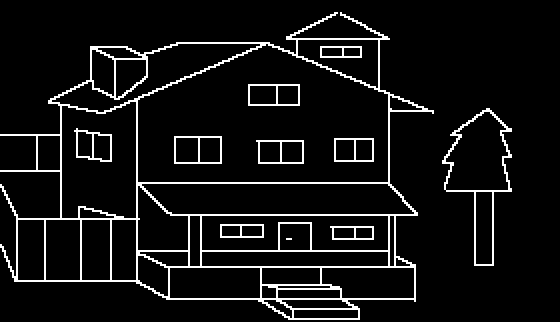
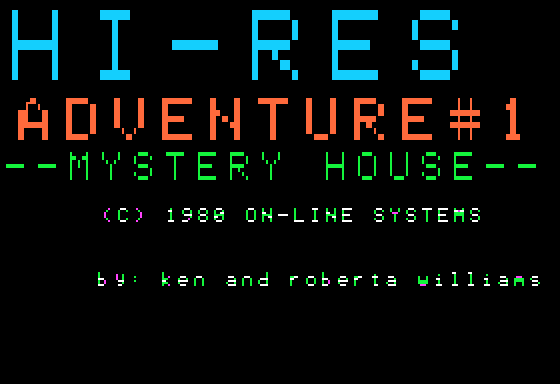
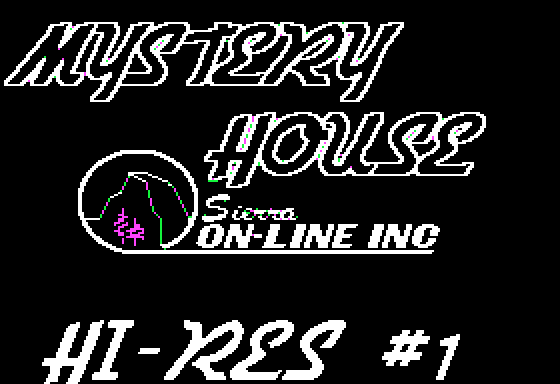
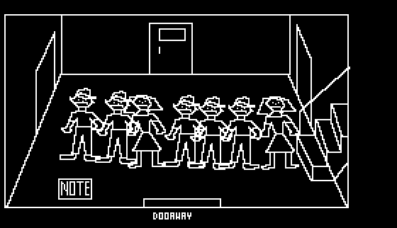
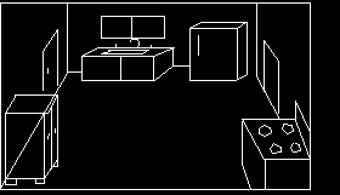

# Mystery House decompilation

[](https://github.com/kDylanHayes/mystery-house-decompilation/actions/workflows/build.yml)

A complete decompilation of *Hi-Res Adventure #1: Mystery House* (Ken and Roberta Williams,
On-Line Systems, 1980) for the Apple II, from the 1987 public-domain release: assembler source
that rebuilds the original files byte for byte, every routine named and documented, and the
whole game database (rooms, objects, words, messages, rules and pictures) decoded.



```
./build.sh            # build everything; ./build.sh --check also fails unless it all matches
python3 -m unittest discover -s tests
```

Needs only python3 (the source is standard ca65; `tools/ca65_check.sh` shows ca65 + ld65 build
the same programs). It builds every file of the game from source (the programs, the messages,
the pictures, the BASIC programs and the saved states) and the disk image around them
(`build/mystery_house.do`, bootable), checks every file against the original's hash and the
disk against its recorded hash, and regenerates the assets. Only DOS 3.3 itself, Apple's code
on tracks 0-2, is kept as a binary.

## Documentation

* [HACKING.md](HACKING.md): the source, the build, and how to change the game
* [CONTRIBUTING.md](CONTRIBUTING.md): the checks, conventions and rules for changes
* [NOTES.md](NOTES.md): how the engine works: the rule interpreter, data formats, graphics,
  messages, the original source found in the binary, bugs and leftovers
* a README.md in each folder: [`src/data`](src/data/README.md), [`tools`](tools/README.md),
  [`programs`](programs/README.md), [`symbols`](symbols/README.md),
  [`decomp`](decomp/README.md), [`original_source`](original_source/README.md),
  [`src/disk`](src/disk/README.md), [`disk`](disk/README.md)

## What's here

| Path | Contents |
|---|---|
| `src/adventure.s` | the game: engine and data, **reassemblable** (standard ca65 syntax), byte-identical to `ADVENTURE` |
| `src/autoload.s` | the 1987 loader and instructions (`AUTO LOAD OBJ`) |
| `src/messages.txt` | the game's 167 messages, one per line; builds the `MESSAGES` file |
| `src/pictures/` | the 97 pictures as editable point lists; build the `BLOCK1`-`BLOCK19` files |
| `src/startup.txt`, `src/saved_game.txt` | the "play again" state and the saved game, as named changes |
| `src/disk/` | the disk's layout, DOS 3.3 (binary) and the stale bytes left on it |
| `src/basic/` | the disk's BASIC programs (start-up credits, title loader, a developer tool) |
| `src/game.inc`, `src/apple2.inc` | named constants: vocabulary, rule opcodes, record layouts; hardware and ROM |
| `original_source/` | 313 lines of the **original 1980 source** (written with the LISA assembler), recovered from stale memory inside the binary |
| `assets/text/rules.txt` | the game logic: all 358 rules in plain words |
| `assets/text/map.txt` | every room's exits and the passages rules make |
| `tests/play/walkthrough.txt` | a complete solution, played by the tests on an emulated 6502 |
| `assets/text/` | rooms, objects, vocabulary, messages; `gamedata.json` has all of it |
| `assets/pictures/` | the 97 vector pictures as PNG and SVG |
| `assets/rooms/` | each of the 41 rooms as first seen, with its objects |
| `assets/shapes/`, `assets/screens/` | the 6 shapes; the 1980 and 1987 title screens |
| `decomp/` | C pseudocode from Ghidra, for reading (optional build step) |
| `extracted/` | every file from the built disk; BASIC programs listed as text |

<p>
 
</p>
<p>
 
</p>

## Source and licence

Built from the TOSEC dump *Hi-Res Adventure 1 - Mystery House (1980)(On-Line Systems)(PD).do*.
Sierra On-Line released the game into the public domain in 1987 (the release's own notice, in
`src/basic/MYSTERY.HELLO.bas`, says so), and the game is all this project holds: every one of
its 30 files is rebuilt from source and checked byte for byte against the original.

This project's own work - the tools, the build, the names, comments and documentation, the
source formats - is released into the public domain too, under the Unlicense (`LICENSE`).

The one exception is DOS 3.3 (`src/disk/dos33.bin`, tracks 0-2 of the built disk), which is
Apple's and is not covered by either: it is kept as an untouched binary only so the disk boots.
`ADVENTURE` also contains a relocated copy of Applesoft's hi-res graphics routines (HGR, HPLOT,
DRAW, ...; NOTES.md, "Pictures"), which the game uses to draw. They are part of the game file
as released and are reproduced here only as part of it.
The original image also carried stale fragments of other, copyrighted software in unused
sectors; those were dropped, so the built disk is a clean copy with its own hash
(`disk/README.md` explains why and records the original's).
